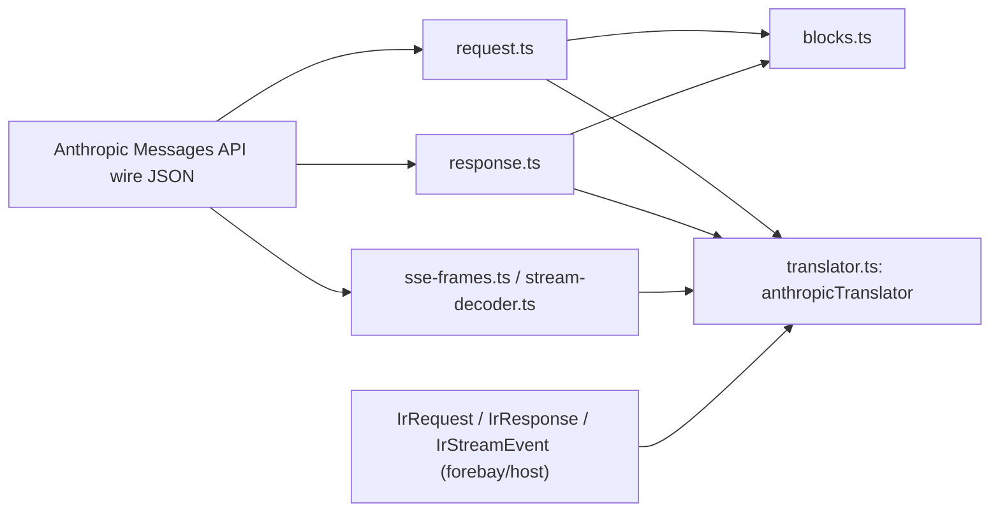

Anthropic Messages API vendor translator for the neutral IR every provider and front door speaks.
It converts the Anthropic wire format (request, response and SSE stream) to and from the IR types
the shared forebay host publishes, in plain TypeScript with no runtime dependency.

## Under-the-Hood Architecture



`anthropicTranslator` decodes a parsed request or response body to IR and encodes IR back to a body,
synchronously. `decodeStream()` and `encodeStream()` return real `TransformStream`s: the decoder
buffers partial lines and frames across chunks, so a frame split at any offset decodes the same as
a whole body. Anything the IR has no typed field for survives in `extensions` (the `$`-prefixed
keys record how the wire was shaped, such as `$systemIsString`, `$contentIsString`,
`$cacheControlExtra`, `$redactedThinkingData` and `$stopReasonRaw`), and a content block of an
unrecognised type travels as an `unknown` block holding its raw object.

## Structure

- `src/translator.ts` - `anthropicTranslator`, the six-function surface.
- `src/request.ts`, `src/response.ts` - the request and response codecs.
- `src/blocks.ts` - the content block codec shared by both.
- `src/stream-decoder.ts`, `src/sse-frames.ts` - SSE frame buffering and frame to event decoding.
- `src/stream-encoder.ts` - IR event to SSE frame encoding.
- `src/usage.ts`, `src/stop-reason.ts`, `src/extensions.ts`, `src/json-values.ts` - small shared pieces.
- `test/vectors/` - golden vectors recorded from the original Java translator, one
  `{direction, input, output}` file each, run by `src/translator.test.ts`.

## Installation

This package is consumed as a sibling checkout and is not published to a registry. It imports the
IR types, type-only, from `@forebay/host`.

## Usage

```ts
import { anthropicTranslator } from "anthropic-translator";

const ir = anthropicTranslator.decodeRequest(wireBody);
const backToWire = anthropicTranslator.encodeRequest(ir);

const response = anthropicTranslator.decodeResponse(responseWireBody);
const wireResponse = anthropicTranslator.encodeResponse(response);

const irEvents = upstreamSseText.pipeThrough(anthropicTranslator.decodeStream());
const wireSse = irEventStream.pipeThrough(anthropicTranslator.encodeStream());
```

## Testing

`npm test` builds, type-checks and runs vitest. Every vector under `test/vectors/` is replayed
through the matching function, the stream vectors through the real `TransformStream`s, and one
recorded SSE body is decoded split at every offset and compared with the unsplit decode.
